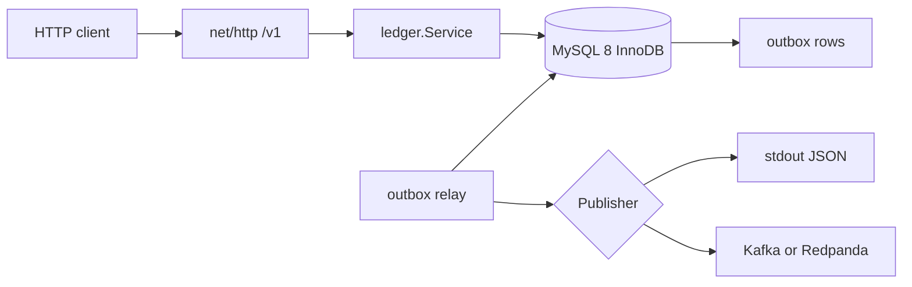
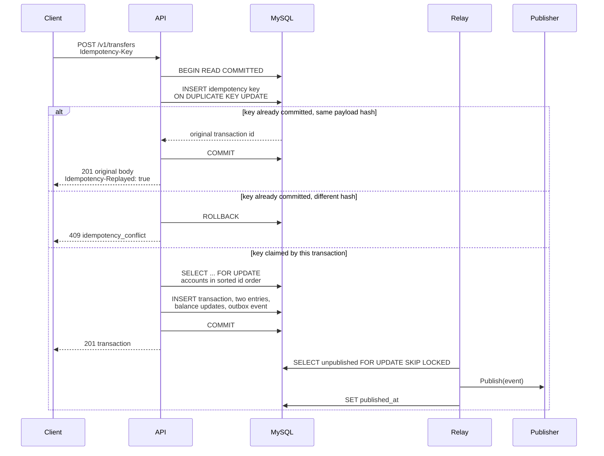
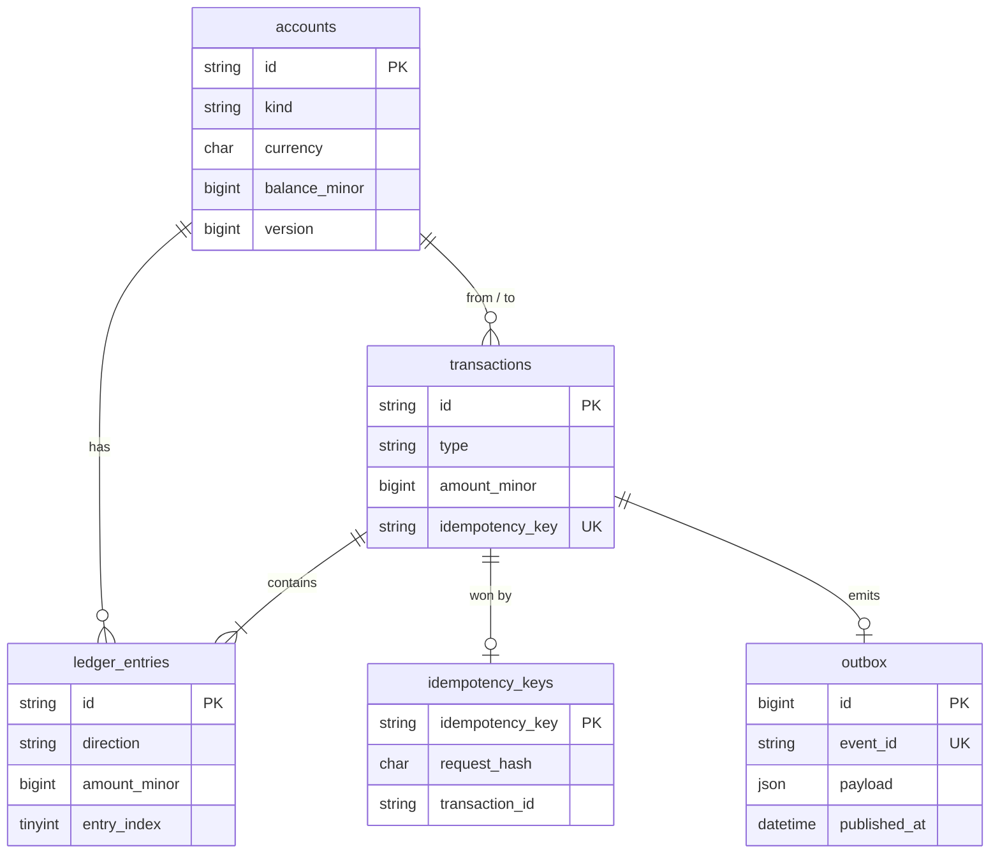

# go-wallet-ledger

A double-entry wallet ledger in Go. It moves money between accounts exactly once, keeps every posting balanced, and stays consistent when clients retry or race.

In-app wallets have a hard correctness bar: a transfer must not lose money, create money, or apply twice because a client timed out and retried. This service is a small, runnable version of that system: an HTTP API, MySQL transactions with an explicit lock order, idempotency keys, and a transactional outbox.

## Problem

A wallet API is called by flaky clients and by other services that retry. Two transfers can touch the same accounts at the same time. The ledger still has to guarantee:

- every movement is a balanced debit and credit
- user balances never go negative
- a retry with the same idempotency key returns the original result
- the same key with a different payload is rejected
- an event is recorded if and only if the movement commits

## Features

- Create an account in one currency, and read the account with its cached balance
- Transfer between user accounts
- Deposit and withdraw against a per-currency system clearing account
- List an account's ledger entries with opaque cursor pagination
- Read a transaction, including both entries
- Require `Idempotency-Key` on every money movement, safe under concurrent duplicate requests
- Liveness (`/v1/health`) and readiness (`/v1/ready`)
- Reconciliation report (HTTP and CLI) for the ledger invariants
- Transactional outbox relay with a log publisher and an optional Kafka/Redpanda publisher
- Structured JSON logs, env configuration, graceful shutdown
- Versioned SQL migrations applied on startup

Amounts are `int64` minor units. There are no floats on the money path.

## Stack

| Piece | Choice | Why |
| --- | --- | --- |
| Language | Go 1.27 | Current stable toolchain, `net/http`, `database/sql`, and `log/slog` cover the service without a framework |
| HTTP | `net/http` ServeMux | Method-and-path routing has been in the standard library since Go 1.22. One less dependency on the request path |
| Database | MySQL 8.0, InnoDB | Row locks, `SELECT ... FOR UPDATE`, `SKIP LOCKED`, and check constraints are the concurrency tools this design uses |
| Driver | `go-sql-driver/mysql` (MPL-2.0) | The usual pure-Go MySQL driver |
| Broker | `segmentio/kafka-go` (MIT), optional | A small producer behind a `Publisher` interface. The default publisher writes JSON logs and needs no broker |
| Migrations | Embedded SQL files | Ordered `00N_*.sql` scripts, recorded in `schema_migrations`. No migration framework |
| Containers | Distroless static, non-root | The binary is `CGO_ENABLED=0`. The runtime image has no shell and no package manager |
| CI | GitHub Actions | `go vet`, golangci-lint, `go test -race` against a MySQL 8 service container, and a Docker build |

## Architecture



Money movement and the outbox insert commit in one database transaction. A background relay claims unpublished rows and hands them to a publisher. The HTTP process is the only writer. Reconciliation takes a repeatable-read snapshot and checks invariants. It does not lock the ledger.

### Transfer with idempotency and the outbox



A business failure such as insufficient funds rolls the idempotency insert back with the rest of the transaction, so the client can retry that key after the balance changes. A successful commit makes the key permanent.

## Data model



Sign convention: `balance_minor = credits - debits`. A user account is a liability and must stay at or above zero. The system account for a currency is the clearing counterparty. A deposit debits it (the balance goes negative, which means value entered from outside the ledger). A withdrawal credits it. Because every transaction is a pair of equal amounts, the sum of all balances in a currency is zero and the signed sum of entries is zero.

Entries store a positive `amount_minor` plus a `direction`. User-facing APIs never accept a float.

Schema lives in `internal/migrate/migrations/001_init.sql`. Startup applies any unrecorded file. `CREATE TABLE IF NOT EXISTS` makes the initial migration safe to retry: MySQL commits DDL implicitly, so a crash between the tables and the `schema_migrations` row can be run again.

## Design decisions

### Locking

Posting runs at `READ COMMITTED` and locks the accounts it will change with `SELECT ... FOR UPDATE`, one primary key at a time, in lexicographic id order (`sortedUnique` in `internal/store/mysqlstore/lock.go`). Transfer A→B and transfer B→A take the same lock sequence, so they wait instead of deadlocking.

The idempotency row is locked first, and only that request's key. Two different keys never wait on each other's idempotency rows, then they take account locks in the same order.

The system clearing account is inserted in its own short autocommit statement before the money transaction. Inserting it inside the money transaction would lock that row before the ordered `FOR UPDATE` and can deadlock with a transfer that already holds a user row.

Optimistic version checks were the other serious option. The balance update still includes `WHERE version = ?` so a mismatched version retries. The version check is a backstop. The lock is what serializes the read-modify-write. Under a hot wallet the transfers on that account must serialize anyway, because there is one balance row. Pessimistic locking lets the waiter proceed with the fresh balance. Optimistic locking would surface more conflicts to the client. The cost is that a hot account's throughput is the throughput of one InnoDB row, and lock waits show up as latency.

InnoDB can still return deadlock `1213` or lock-wait timeout `1205` from secondary-index inserts. Those errors retry the whole posting up to three times. If they persist, the client gets `503 temporarily_unavailable` and the idempotency key is not consumed.

`innodb_lock_wait_timeout` is set on the connection that owns the transaction (default 10s).

### Idempotency

The key is global across deposit, withdrawal, and transfer. The request hash is SHA-256 of the operation name plus the canonical JSON of the semantic fields. The key itself is not part of the hash: it is the lookup, and the body is what must match.

The hash row is inserted in the same transaction as the ledger write. Concurrent duplicates block on the unique index until the winner commits, then they read that transaction and return it. A same-key request with a different hash gets `409`. There is no separate "in progress" row left behind on a crash, because an uncommitted claim disappears with the rollback. Callers that collide wait (up to the lock timeout) instead of receiving a synthetic in-progress error.

Replays return HTTP `201` and the same transaction, with `Idempotency-Replayed: true`.

### Outbox and delivery

The outbox insert commits with the ledger rows, so a rolled-back movement does not emit an event and a committed movement does not forget one. The relay claims a batch with `FOR UPDATE SKIP LOCKED`, stamps a lease (`locked_until`), commits that claim, publishes, then sets `published_at`. Publishing sits outside the row lock so a slow broker does not pin the batch. A crash after publish and before `published_at` delivers the event again after the lease expires.

That is at-least-once delivery. The database effect for one idempotency key is exactly once. End-to-end exactly-once across MySQL and Kafka would need a distributed transaction or an idempotent consumer that can prove the side effect. This service does the first half and puts `event_id` on every event so a consumer can do the second half. The Kafka writer uses `acks=all` and the transaction id as the message key.

`PUBLISHER=log` is the default and writes one JSON log line per event. `PUBLISHER=kafka` uses the brokers in `KAFKA_BROKERS`.

### Reconciliation snapshot

Reconciliation uses one `REPEATABLE READ` read-only transaction. At `READ COMMITTED`, each statement would have its own snapshot, and a transfer committing between the entry sum and the balance comparison could look like a mismatch. The repeatable-read snapshot cannot see a half-committed posting, and our postings commit their entries together.

The report checks:

- signed sum of entries per currency is zero
- each cached balance equals the sum of that account's entries
- every transaction has a net of zero and exactly two entries
- no committed idempotency row is missing its transaction id

`GET /v1/reconciliation` returns `200` with `"ok": false` when an invariant fails. The query itself failing is a `500`. `ledger reconcile` prints the same JSON and exits `2` when `ok` is false.

## Layout

```
cmd/ledger          serve (default), seed, reconcile
cmd/loadtest        small closed-loop transfer client
internal/domain     amounts, hashes, error codes
internal/ledger     validation and use cases
internal/store/mysqlstore
internal/outbox     relay and publishers
internal/httpapi    /v1 JSON API
internal/migrate    embedded SQL
internal/seed       demo accounts
```

## Configuration

The process reads the environment. It does not load `.env` files. Copy `.env.example` and export the variables, or use Compose, which sets them itself.

| Variable | Default | Role |
| --- | --- | --- |
| `HTTP_ADDR` | `:8080` | Listen address |
| `MYSQL_DSN` | required | Must include `parseTime=true` and `loc=UTC` |
| `PUBLISHER` | `log` | `log` or `kafka` |
| `KAFKA_BROKERS` | empty | Comma-separated, required when `PUBLISHER=kafka` |
| `KAFKA_TOPIC` | `ledger.events` | Topic for the Kafka publisher |
| `LOG_LEVEL` | `info` | `debug`, `info`, `warn`, `error` |
| `OUTBOX_POLL_INTERVAL` | `500ms` | Delay between relay polls |
| `OUTBOX_BATCH_SIZE` | `50` | Rows claimed per batch |
| `OUTBOX_LEASE` | `30s` | How long a claimed row stays hidden from other relays |
| `SHUTDOWN_TIMEOUT` | `15s` | HTTP drain budget, then a final outbox drain |
| `LOCK_WAIT_TIMEOUT` | `10s` | Session `innodb_lock_wait_timeout` for postings |
| `DB_MAX_OPEN_CONNS` | `25` | Pool size |
| `DB_MAX_IDLE_CONNS` | `10` | Idle pool size |

Compose uses the local development password `ledger` for the database user. That value is a demo default. `.env.example` uses placeholders only.

## Run

Local MySQL 8:

```bash
export MYSQL_DSN='ledger:ledger@tcp(127.0.0.1:3306)/ledger?parseTime=true&charset=utf8mb4&loc=UTC'
go run ./cmd/ledger seed
go run ./cmd/ledger serve
```

`scripts/seed.sh` is the same seed command. It is safe to run twice: account ids are fixed, and each opening deposit has its own idempotency key, so money is not credited again.

Docker Compose (app + MySQL). Nothing else should be bound to host port 3306.

```bash
docker compose up --build -d
docker compose run --rm app seed
curl -s localhost:8080/v1/ready
```

Optional broker:

```bash
PUBLISHER=kafka docker compose --profile kafka up --build
```

The app container reaches Redpanda at `redpanda:9092`. Host tools can use `localhost:19092`.

### Demo accounts

| Name | Id | Currency | Opening balance |
| --- | --- | --- | --- |
| Alice | `11111111-1111-4111-8111-111111111111` | USD | 100000 |
| Bob | `22222222-2222-4222-8222-222222222222` | USD | 25000 |
| Carol | `33333333-3333-4333-8333-333333333333` | EUR | 50000 |

System clearing accounts are deterministic UUIDv5 ids:

| Currency | Id |
| --- | --- |
| USD | `cdbed40e-ca6e-5226-8528-3f4c2a7842f9` |
| EUR | `a2bf6d2c-939a-5e65-b6c9-2ad521812d60` |

After a fresh seed the USD system balance is `-125000` and the EUR system balance is `-50000`.

## API

Base URL `http://localhost:8080`. Money endpoints require `Content-Type: application/json` and `Idempotency-Key` (1–128 characters from `[A-Za-z0-9._:~-]`). Unknown JSON fields are rejected. `amount_minor` must be a positive integer up to `10^15`.

| Method | Path | Success |
| --- | --- | --- |
| `GET` | `/v1/health` | `200 {"status":"ok"}` |
| `GET` | `/v1/ready` | `200` when MySQL pings, otherwise `503` |
| `POST` | `/v1/accounts` | `201` account |
| `GET` | `/v1/accounts/{id}` | `200` account |
| `GET` | `/v1/accounts/{id}/entries?limit=&cursor=` | `200` page. `limit` default 50, max 200 |
| `POST` | `/v1/transfers` | `201` transaction |
| `POST` | `/v1/deposits` | `201` transaction |
| `POST` | `/v1/withdrawals` | `201` transaction |
| `GET` | `/v1/transactions/{id}` | `200` transaction |
| `GET` | `/v1/reconciliation` | `200` report |

Error body:

```json
{"error":{"code":"insufficient_funds","message":"account balance is too low for this debit"}}
```

| HTTP | `code` | When |
| --- | --- | --- |
| 400 | `validation_error` | Bad JSON, amount, currency, id, cursor, or idempotency key |
| 400 | `idempotency_key_required` | Money POST without the header |
| 404 | `not_found` | Unknown account or transaction |
| 409 | `idempotency_conflict` | Same key, different payload |
| 409 | `account_exists` | Seed id reused with another currency |
| 415 | `unsupported_media_type` | Body is not JSON |
| 422 | `insufficient_funds` | User debit would go below zero |
| 422 | `currency_mismatch` | Account currency does not match the request |
| 422 | `same_account` | Source and destination are the same |
| 422 | `invalid_account_kind` | Transfer touching a system account, or a deposit/withdrawal aimed at the wrong kind |
| 422 | `overflow` | The `int64` balance would overflow |
| 503 | `temporarily_unavailable` | Lock contention exhausted retries. Retry the same key |
| 500 | `internal_error` | Unexpected failure. The body does not include the internal error |

Create an account:

```bash
curl -s -X POST localhost:8080/v1/accounts \
  -H 'Content-Type: application/json' \
  -d '{"currency":"USD"}'
```

```json
{
  "id": "01a16661-b837-7d97-89d1-9dcee8b9a1a6",
  "kind": "user",
  "currency": "USD",
  "balance_minor": 0,
  "version": 0,
  "created_at": "2026-10-23T01:30:42.615159Z",
  "updated_at": "2026-10-23T01:30:42.615159Z"
}
```

The response also sets `Location: /v1/accounts/{id}`.

Deposit. The `from_account_id` on a deposit is the system clearing account. A withdrawal reverses the direction.

```bash
curl -s -X POST localhost:8080/v1/deposits \
  -H 'Content-Type: application/json' \
  -H 'Idempotency-Key: readme-dep' \
  -d '{"account_id":"01a16661-b837-7d97-89d1-9dcee8b9a1a6","amount_minor":1000,"currency":"USD"}'
```

Transfer between the seeded accounts:

```bash
curl -s -X POST localhost:8080/v1/transfers \
  -H 'Content-Type: application/json' \
  -H 'Idempotency-Key: demo-transfer-1' \
  -d '{
    "from_account_id":"11111111-1111-4111-8111-111111111111",
    "to_account_id":"22222222-2222-4222-8222-222222222222",
    "amount_minor":500,
    "currency":"USD"
  }'
```

A retry of that exact request returns the same transaction id and `Idempotency-Replayed: true`. The same key with `"amount_minor": 501` returns:

```json
{"error":{"code":"idempotency_conflict","message":"this Idempotency-Key was already used with a different request"}}
```

Withdraw:

```bash
curl -s -X POST localhost:8080/v1/withdrawals \
  -H 'Content-Type: application/json' \
  -H 'Idempotency-Key: demo-withdraw-1' \
  -d '{"account_id":"22222222-2222-4222-8222-222222222222","amount_minor":100,"currency":"USD"}'
```

Entries, newest first:

```bash
curl -s 'localhost:8080/v1/accounts/11111111-1111-4111-8111-111111111111/entries?limit=1'
```

Pass `next_cursor` back as `cursor`. The token is opaque. A zero amount is rejected:

```json
{"error":{"code":"validation_error","message":"amount_minor must be a positive integer","fields":{"amount_minor":"must be > 0"}}}
```

Reconcile:

```bash
curl -s localhost:8080/v1/reconciliation
go run ./cmd/ledger reconcile
```

## Testing

Unit tests cover currency and amount rules, the request hash, uuid generation, cursor tokens, SQL splitting, lock order, config parsing, and the outbox relay with fakes.

Integration tests use a real MySQL 8. Set `MYSQL_DSN` (same shape as above). Without it they skip. In CI, `REQUIRE_INTEGRATION=1` turns a missing database into a failure.

```bash
go test ./...
MYSQL_DSN='ledger:ledger@tcp(127.0.0.1:3306)/ledger?parseTime=true&charset=utf8mb4&loc=UTC' \
  REQUIRE_INTEGRATION=1 go test -race -count=1 ./...
```

`make test-integration` runs that second command. The race-enabled suite includes:

- parallel unique transfers that drain one account to zero and check both balances
- many goroutines posting one idempotency key, all observing one transaction id
- the same key with two different amounts, exactly one of those amounts applied
- many withdrawals racing for a balance that can pay only one of them
- opposing transfers, then an invariant check

golangci-lint config is `.golangci.yml` (v2.15.0). `make lint` runs it.

### Load smoke

`cmd/loadtest` creates two accounts, deposits enough to cover the transfers, runs them, and exits non-zero if any request fails or the balances do not add up.

```bash
go run ./cmd/loadtest -base-url http://127.0.0.1:8080 -requests 200 -concurrency 20 -amount 1
```

One run on the development VM used to build this repository (Linux, 4 vCPU, Go 1.27.3, MySQL 8.0.46 on localhost, `PUBLISHER=log`, server started with `go run`):

```
requests 200
concurrency 20
success 200
errors 0
elapsed_ms 467
latency_ms_p50 46
latency_ms_p95 54
latency_ms_max 56
from_balance 0
to_balance 200
```

That is a single local smoke measurement, not a capacity result. A few seconds later, `SELECT COUNT(*) FROM outbox WHERE published_at IS NULL` returned 0.

## Limitations and future work

- One MySQL primary. A hot account is limited by one row lock. Splitting hot wallets or batching would be a different design.
- No authentication or authorization. Put the process on a private network.
- Reconciliation scans the ledger. A large history wants checkpoints or a warehouse job, not a request-path full scan.
- Delivery to the publisher is at-least-once. Consumers must dedupe on `event_id`.
- No pending holds, no multi-leg postings beyond a single debit/credit pair, no FX between currencies.
- The optional Redpanda service is for local experiments. Broker TLS, SASL, and a transactional consumer are not wired up.
- Metrics and traces are not exported. Logs carry `request_id`.

## AI assistance

This project was built with AI assistance. The requirements and design goals were mine; I reviewed, ran and tested the result, and I can walk through the design decisions.

## License

MIT. See [LICENSE](LICENSE).
